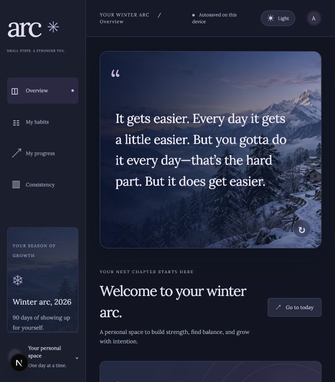

# Arc — Winter Arc 2026

A personal fitness, routine, and habit tracker for a 90-day challenge from October 3 to December 31, 2026.

Arc is built around three pillars: physical health, mental health, and personal development. It uses Lora with a blue, lavender, and cool mint palette.

## Features

- Overview with the inspiration behind Arc and detailed pillar introductions
- Daily habit tracking, custom habits, and pillar filters
- A 90-day progress calendar, consistency, streaks, and completed intentions
- Mood and hydration check-ins
- Daily reflections with autosave, directly inside each day in My Progress
- A Consistency dashboard with daily bars, pillar completion rings, habit rankings, and focus suggestions
- Date-specific records for habits, mood, water, and reflections
- A day log editor, individual entry deletion, whole-day deletion, and undo
- Downloadable JSON backups, readable Markdown journals, and backup restore
- Responsive layouts

Entries are saved automatically in this website’s local storage in your current browser. Select any day in My Progress to view and update its record. Records survive reloads, but are separate for each website address, browser, and device. There is no account or cloud sync.

Use Download backup in My Progress or Consistency to keep a JSON copy and Restore a backup to move records to another browser or website address. Download journal exports a readable Markdown file. Restoring combines completed habits and retains current reflections, mood, and water entries on conflicting dates. Clearing browser data removes the local copy. If saving fails, Arc displays an alert and retains the current edits in memory so you can download them before leaving.

## Run locally

Install Node.js 20.9 or newer and pnpm 11.25.0.

```sh
pnpm install
pnpm dev
```

Open http://localhost:3000.

## Checks and production

```sh
pnpm lint
pnpm exec tsc --noEmit
pnpm build
pnpm start
```

Built with Next.js, React, TypeScript, and Tailwind CSS. Lora is loaded through `next/font/google`, so an initial build needs access to Google Fonts.

## Preview



## Edit or delete entries

Select a day in My Progress, then choose Edit day’s log to update completed habits, mood, water, and reflection together. Save changes commits the edits; Cancel discards the draft. Delete day’s log clears that date’s entries without removing habits or other days. Individual reflections, mood logs, and water logs also have delete or clear controls. The undo notification restores the last deletion until the next deletion, dismissal, or page refresh. Undo preserves newer entries if you have already recorded something in the same field.

## Consistency insights

Use Consistency to compare the last 7 days, the last 30 days, or the elapsed winter arc. Future days are excluded; unlogged days count as zero completed habits. Pillar rates compare completed habits against eligible habit-days. Habits added in this version count from their creation date; older habits without this date count from the start of the challenge. Charts update from saved records and link to each day in My Progress. The focus suggestion highlights the lowest-completed pillar without presenting habit completion as a wellbeing score.
