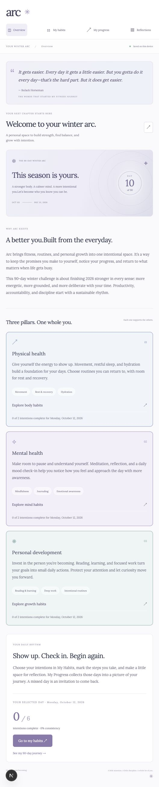

# Arc — Winter Arc 2026

A personal fitness, routine, and habit tracker for a 90-day challenge from October 3 to December 31, 2026.

Arc is built around three pillars: physical health, mental health, and personal development. It uses Lora with a blue, lavender, and cool mint palette.

## Features

- Overview with the inspiration behind Arc and detailed pillar introductions
- Daily habit tracking, custom habits, and pillar filters
- A 90-day progress calendar, consistency, streaks, and completed intentions
- Mood and hydration check-ins
- Daily reflections
- Responsive layouts

Entries are stored in your browser’s local storage on the current device. There is no account or cloud sync.

## Run locally

Install Node.js 20.9 or newer and pnpm 11.25.0.

```sh
pnpm install
pnpm dev
```

Open http://localhost:3000.

## Checks and production

```sh
pnpm lint
pnpm exec tsc --noEmit
pnpm build
pnpm start
```

Built with Next.js, React, TypeScript, and Tailwind CSS. Lora is loaded through `next/font/google`, so an initial build needs access to Google Fonts.

## Preview


